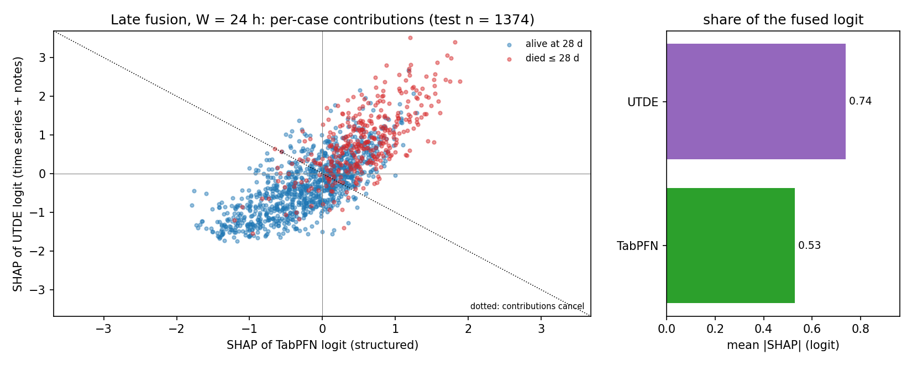
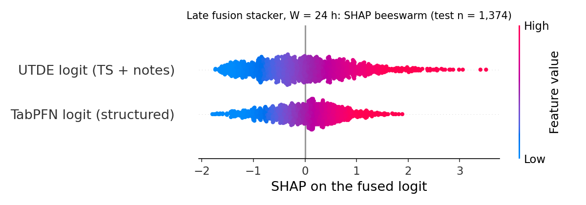
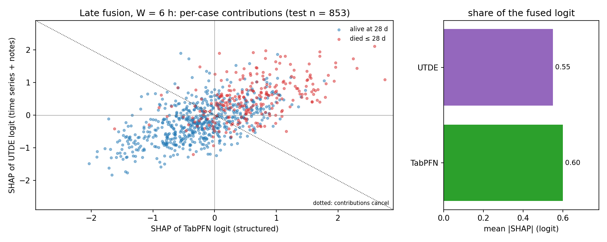
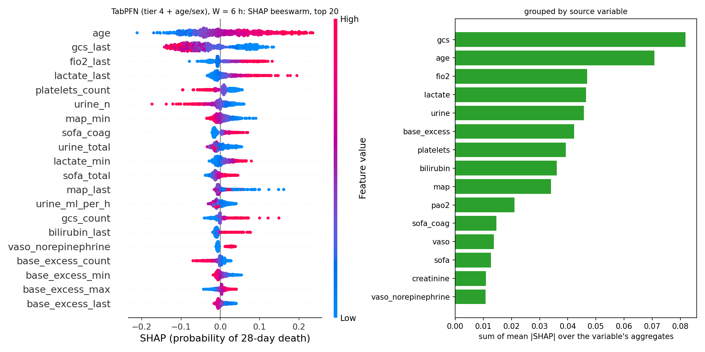
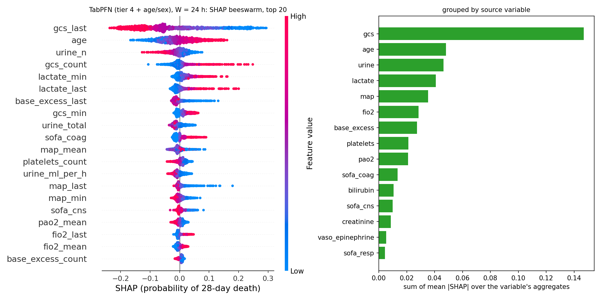
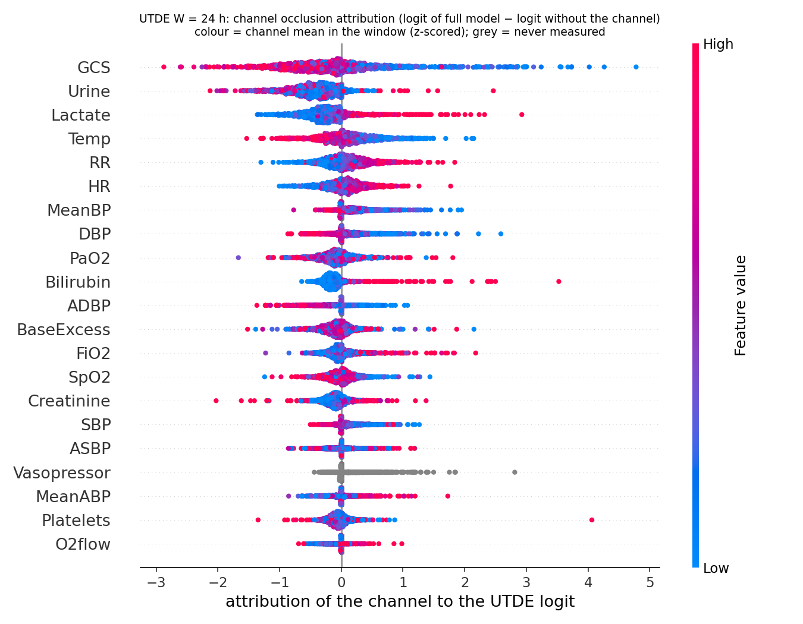
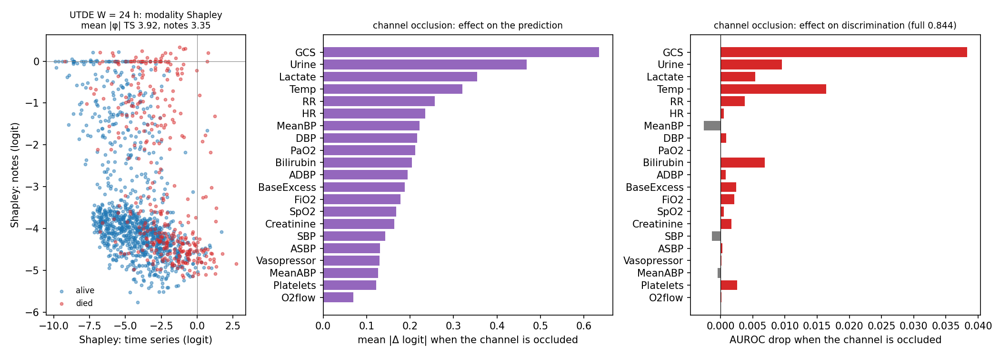
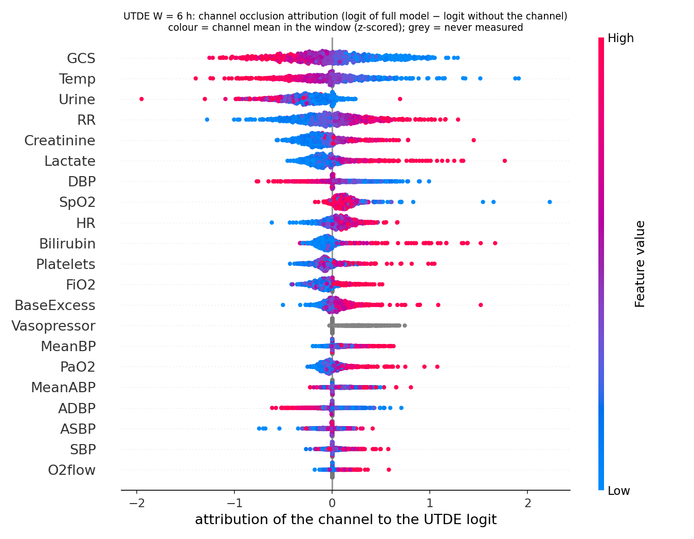

# SHAP / attribution report: TabPFN, UTDE and their late fusion

Test split of the SOFA cohort (6 h: 853 stays, 24 h: 1,374 stays), 28-day mortality. Three levels of explanation, one per model:

| model | method | unit |
|---|---|---|
| late fusion (logistic stacker) | exact SHAP of a linear model in logit space: φ_k = b_k (x_k − mean x_k) | fused logit |
| TabPFN v2 (68 structured features) | permutation SHAP (`shap.PermutationExplainer`, 10 background rows, 2F+1 = 137 evaluations per case, all test cases) | probability of death |
| UTDE (21 channels + notes) | occlusion: a channel's values and masks zeroed in both inputs; notes replaced by the training placeholder; 2-player Shapley for the modalities | logit / AUROC |

## 1. Late fusion — which model drives the fused prediction?

| W | stacker coef TabPFN / UTDE | mean abs SHAP TabPFN / UTDE | UTDE share | corr(logits) | cases where the two disagree | AUROC on those: fusion / TabPFN / UTDE | AUROC where they agree |
|---|---|---|---|---|---|---|---|
| 6 h | 0.55 / 0.54 | 0.60 / 0.55 | 48% | 0.67 | 26% | 0.598 / 0.659 / 0.389 | 0.883 |
| 24 h | 0.41 / 0.43 | 0.53 / 0.74 | 58% | 0.79 | 21% | 0.600 / 0.565 / 0.524 | 0.886 |

* The stacker weights the two logits almost equally; the split of the fused logit follows the spread of each input: UTDE (58 %) at 24 h, TabPFN (52 %) at 6 h.
* Points lie along the y = x diagonal, not the cancellation diagonal: the fusion mostly *reinforces* a shared direction rather than arbitrating opposite votes.
* Where the two models point in opposite directions (21 % of 24 h cases) the fusion is better than either (0.600 vs 0.565 / 0.524); at 6 h UTDE is confidently wrong on part of these (0.389) and the fusion lands in between (0.598 vs TabPFN 0.659).

## 2. TabPFN — which structured features?

### 6 h (mean |SHAP| in probability units)

| rank | feature | mean abs SHAP | mean SHAP | | variable group | sum of mean abs SHAP |
|---|---|---|---|---|---|---|
| 1 | `age` | 0.071 | +0.016 | | gcs | 0.082 |
| 2 | `gcs_last` | 0.069 | -0.031 | | age | 0.071 |
| 3 | `fio2_last` | 0.031 | +0.011 | | fio2 | 0.047 |
| 4 | `lactate_last` | 0.022 | +0.008 | | lactate | 0.046 |
| 5 | `platelets_count` | 0.021 | +0.012 | | urine | 0.046 |
| 6 | `urine_n` | 0.020 | +0.000 | | base_excess | 0.042 |
| 7 | `map_min` | 0.015 | +0.006 | | platelets | 0.039 |
| 8 | `sofa_coag` | 0.015 | -0.004 | | bilirubin | 0.036 |
| 9 | `urine_total` | 0.014 | +0.001 | | map | 0.034 |
| 10 | `lactate_min` | 0.013 | +0.004 | | pao2 | 0.021 |
| 11 | `sofa_total` | 0.013 | -0.008 | | sofa_coag | 0.015 |
| 12 | `map_last` | 0.012 | +0.004 | | vaso | 0.014 |

### 24 h (mean |SHAP| in probability units)

| rank | feature | mean abs SHAP | mean SHAP | | variable group | sum of mean abs SHAP |
|---|---|---|---|---|---|---|
| 1 | `gcs_last` | 0.111 | -0.027 | | gcs | 0.147 |
| 2 | `age` | 0.048 | -0.005 | | age | 0.048 |
| 3 | `urine_n` | 0.021 | -0.002 | | urine | 0.046 |
| 4 | `gcs_count` | 0.020 | +0.003 | | lactate | 0.041 |
| 5 | `lactate_min` | 0.019 | +0.014 | | map | 0.035 |
| 6 | `lactate_last` | 0.018 | +0.002 | | fio2 | 0.029 |
| 7 | `base_excess_last` | 0.017 | -0.003 | | base_excess | 0.027 |
| 8 | `gcs_min` | 0.016 | +0.009 | | platelets | 0.021 |
| 9 | `urine_total` | 0.015 | -0.004 | | pao2 | 0.021 |
| 10 | `sofa_coag` | 0.014 | -0.002 | | sofa_coag | 0.014 |
| 11 | `map_mean` | 0.012 | -0.003 | | bilirubin | 0.011 |
| 12 | `platelets_count` | 0.012 | +0.008 | | sofa_cns | 0.010 |

* 24 h: `gcs_last` alone carries 0.111 (next feature 0.048); grouped, GCS ≫ age ≈ urine > lactate > MAP > FiO2 ≈ BE.
* 6 h: age (0.071) and GCS (0.069) tie; FiO2_last is third — in the first hours prior risk and oxygen requirement weigh as much as the neurological state; the physiological trajectories take over by 24 h.
* Directions (colour in the beeswarms) are clinical: low GCS, low urine, high lactate, low base excess, high FiO2, high age → death.
* Measurement-count features (`urine_n`, `gcs_count`, `platelets_count`) rank in the top 12 at both windows: the model also learns *how often* things were charted, i.e. part of the signal is the care pattern, not physiology (the selection-bias analysis of the main project quantifies this).

## 3. UTDE — which modality, which channels?

| W | full | without notes | without time series | notes only vs TS only |
|---|---|---|---|---|
| 6 h | 0.798 | 0.786 (−0.011) | 0.621 (−0.177) | 0.621 vs 0.786 |
| 24 h | 0.844 | 0.819 (−0.024) | 0.681 (−0.163) | 0.681 vs 0.819 |

| W | channels by mean abs Δlogit when occluded (top 8) | channels by AUROC drop (top 5) |
|---|---|---|
| 6 h | GCS 0.36, Temp 0.28, Urine 0.28, RR 0.26, Creatinine 0.18, Lactate 0.17, DBP 0.15, SpO2 0.14 | GCS −0.030, RR −0.015, Urine −0.013, Bilirubin −0.011, Temp −0.010 |
| 24 h | GCS 0.63, Urine 0.47, Lactate 0.35, Temp 0.32, RR 0.26, HR 0.24, MeanBP 0.22, DBP 0.22 | GCS −0.038, Temp −0.016, Urine −0.010, Bilirubin −0.007, Lactate −0.005 |

* GCS dominates in both windows (AUROC −0.038 / −0.030 when removed). At 24 h urine, lactate, temperature, RR, HR follow; at 6 h temperature, urine, RR, creatinine — lactate matters less because a single early value carries no trend.
* Colour patterns match physiology: low GCS, low urine, high lactate, high bilirubin, low temperature, high RR → death. Vasopressor (0/1) adds little on its own because its information is in MAP/HR.
* Notes are worth 0.025 AUROC at 24 h and 0.012 at 6 h (bedside notes exist for 72 % vs 44 % of stays); notes alone reach 0.68 / 0.62. The modality-Shapley scatter uses an out-of-distribution "nothing" baseline, so read the modality question from the AUROC drops, not from the absolute φ values.

## 4. Reading the three together

| | TabPFN (structured) | UTDE (time series + notes) |
|---|---|---|
| #1 driver | GCS (last value) | GCS (channel) |
| next | age, urine count, lactate, BE, MAP | urine, lactate, temperature, RR / HR |
| unique to it | age / sex; charting-count features; window aggregates (min / max / mean) | notes; temperature / RR / HR trajectories; time of each note |
| share of the fused logit | 52 % (6 h) / 42 % (24 h) | 48 % (6 h) / 58 % (24 h) |

1. The two models agree on the top variables (GCS, urine output, lactate), which is why their logits correlate at 0.67–0.79 and the fusion gain is bounded (+0.014 at 6 h, +0.023 at 24 h).
2. The gain comes from what each has and the other lacks: the structured model contributes age/sex and record-pattern counts, UTDE contributes the notes and finer vital-sign dynamics.
3. Time matters: in the first 6 h the structured model leads (prior risk, oxygen need), by 24 h UTDE leads (accumulated trajectories and notes). A deployment could weight the stacker by elapsed time.
4. Two cheap follow-ups fall out of the attribution: give UTDE age and sex (the structured model's #2 feature at 6 h is absent from UTDE), and raise UTDE's note budget (5 → 10; 63 % of 24 h stays have more than 5 notes).
5. Caveat for both: measurement-count features and note availability encode the care process; the models are valid for the cohort they were trained on (stays with an arterial gas and lactate in the window), not for all ICU admissions.

Files: `fusion_W{6,24}.json`, `tabpfn_shap_W{6,24}.csv`, `utde_attr_W{6,24}.json`, figures `*.png`; produced by `21_fusion_shap.py`, `utde_attr.py` (UTDE adapter) and `22_fusion_shap_figs.py`.
