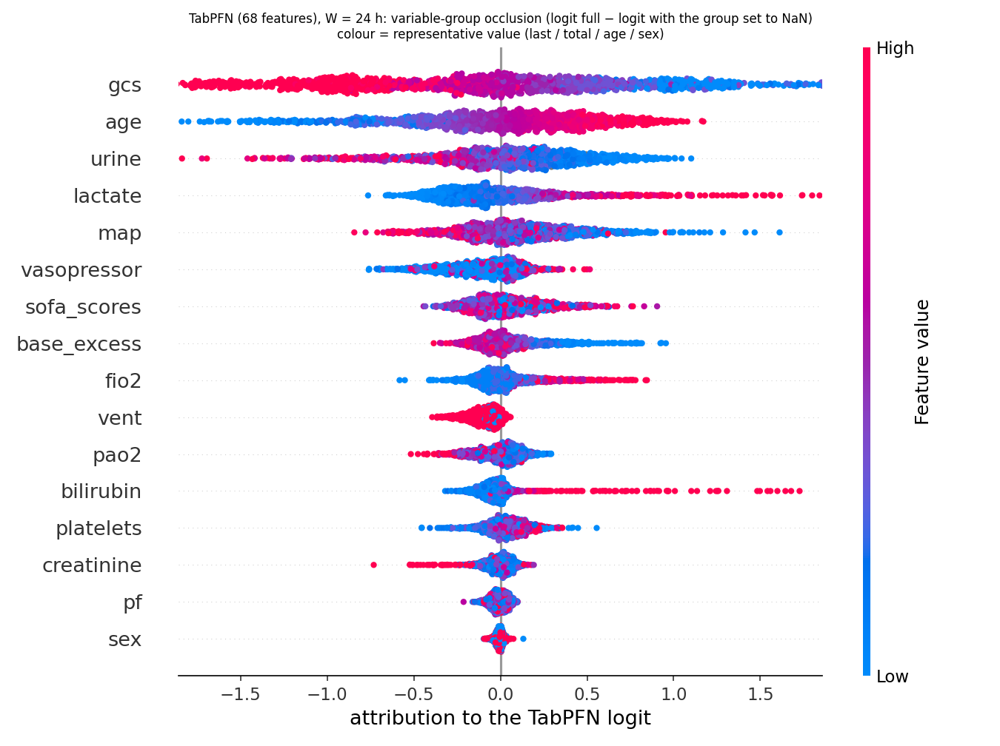
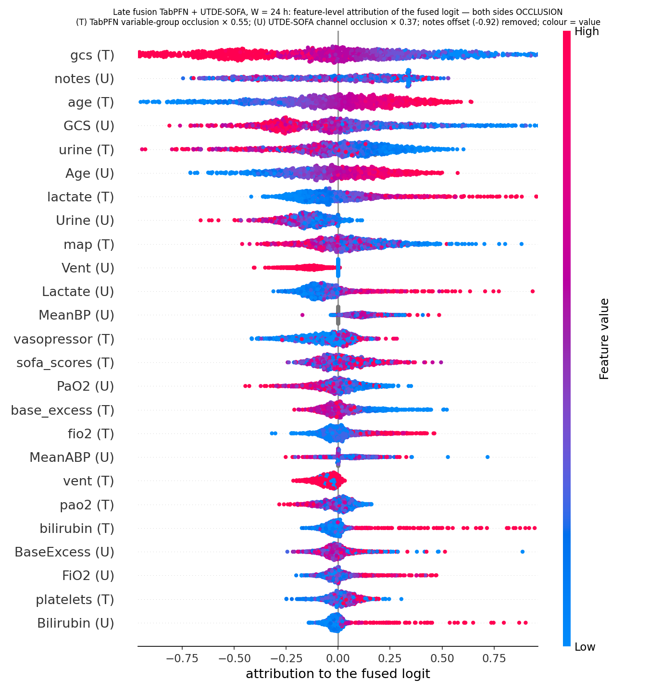
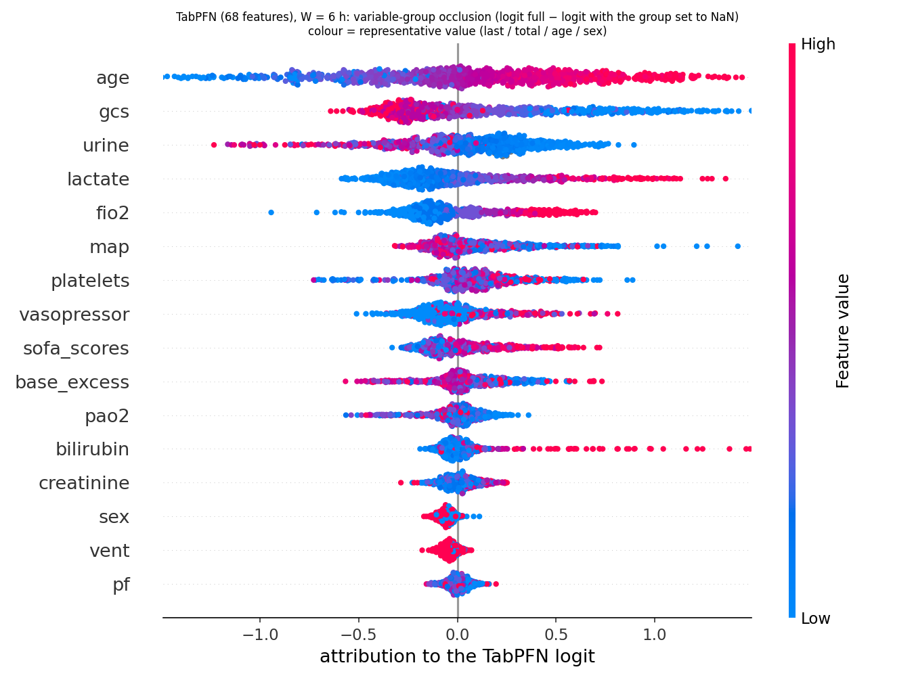
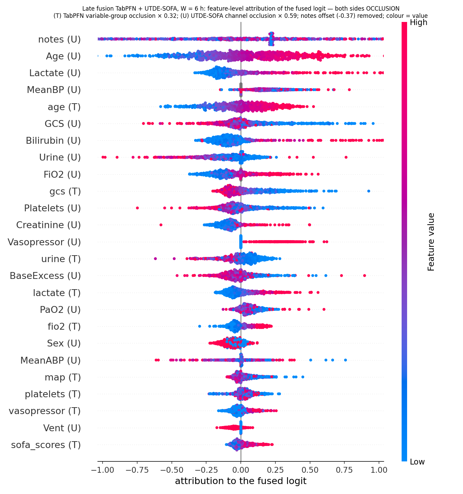

# Attribution report — unified variable set (SOFA inputs + lactate/BE + vent + age/sex)

Models of the unified table: TabPFN (68 features), UTDE-SOFA (15 channels + notes), late fusion TabPFN + UTDE-SOFA, TabPFN-in-UTDE replace, TabPFN-in-UTDE 3-stream. Test split: 853 (6 h) / 1,374 (24 h).

| model | method | figure |
|---|---|---|
| TabPFN | **variable-group occlusion** (group's columns → NaN = 'not measured', re-predict; Δlogit and AUROC drop) — the method used for every cross-model comparison | `tabpfn_occlusion_beeswarm_W{6,24}.png`, `tabpfn_occlusion_W{6,24}.csv` |
| TabPFN (deep dive only) | permutation SHAP (all test cases, probability units); TabPFN-only, not compared numerically with other models | `../fusion_shap/tabpfn_shap_W{6,24}.png` |
| UTDE-SOFA | occlusion: modality (notes / time series), per channel; beeswarm coloured by channel mean | `utde_sofa_beeswarm_W{6,24}.png` |
| late fusion | exact SHAP of the logistic stacker (2 inputs) + feature-level beeswarm with **both sides occlusion** ((T) TabPFN group occlusion × b₁, (U) UTDE-SOFA channel occlusion × b₂, notes offset-centred, all in fused-logit units) | `fusion_sofa_stacker_W{6,24}.png`, `fusion_sofa_feature_occlusion_W{6,24}.png` (older mixed version SHAP × b₁: `fusion_sofa_feature_beeswarm_W{6,24}.png`, superseded) |
| replace | occlusion of the TabPFN tokens and of the notes (no time-series stream) | table only |
| 3-stream | occlusion of the TabPFN tokens, notes, time-series stream and each channel; channel beeswarm | `tabemb3_sofa_beeswarm_W{6,24}.png` |

## Headline numbers

| model | 6 h: drives it | 6 h: notes removed | 24 h: drives it | 24 h: notes removed |
|---|---|---|---|---|
| TabPFN (occlusion) | age (−0.022) > GCS (−0.042 AUROC but smaller Δlogit 0.40 vs 0.51) > urine, bilirubin, platelets | – | GCS (−0.059) ≫ age (−0.017) ≈ urine (−0.016) > SOFA scores (−0.009) | – |
| UTDE-SOFA | Age (−0.023) ≈ GCS (−0.024) > bilirubin, BE | 0.823 → 0.805 (−0.018) | GCS (−0.057) > Age (−0.020) > lactate, PaO2 | 0.826 → 0.803 (−0.023) |
| late fusion | UTDE-SOFA logit 69 %; notes (U) 0.38 > Age (U) 0.29 > Lactate (U), MeanBP (U), age (T) | via UTDE logit | TabPFN logit 61 %; gcs (T) 0.42 > notes (U) 0.24 ≈ age (T) 0.24 ≈ GCS (U) 0.23 | via UTDE logit |
| replace | TabPFN tokens (−0.251) | 0.827 → 0.826 (−0.001) | TabPFN tokens (−0.274) | 0.836 → 0.834 (−0.002) |
| 3-stream | TabPFN tokens (−0.050) > notes ≈ TS (−0.007) | 0.835 → 0.828 (−0.007) | TabPFN tokens (−0.091) > notes (−0.016) > TS (−0.005) | 0.856 → 0.840 (−0.016) |

## Why occlusion on both sides (added 2026-10-28)

SHAP (permutation, probability units, averaged over feature coalitions) and occlusion (one group removed, no retraining, logit units) answer different questions and have different units, so a ranking that mixes them — as the first fusion feature-level figure did with (T) SHAP × b₁ next to (U) occlusion × b₂ — is not a like-for-like comparison. Every cross-model figure and table is therefore now occlusion-only: TabPFN is occluded by variable group (all aggregate columns of a variable set to NaN, which TabPFN treats as "not measured"), UTDE-SOFA by channel (values and mask zeroed), the TabPFN-in-UTDE models by token / note / channel. Permutation SHAP is kept only for the TabPFN-only deep dive (`../fusion_shap/tabpfn_shap_W{6,24}.png`); its ranking agrees with the group occlusion (GCS ≫ age > urine > lactate at 24 h).

Same variable removed from both models, test AUROC drop (mean |Δlogit| in brackets) — full tables in `occlusion_table_W{6,24}.md`:

| variable | TabPFN 6 h | UTDE-SOFA 6 h | TabPFN 24 h | UTDE-SOFA 24 h |
|---|---|---|---|---|
| GCS | −0.042 [0.40] | −0.024 [0.27] | −0.059 [0.77] | −0.057 [0.62] |
| Age | −0.022 [0.51] | −0.023 [0.50] | −0.017 [0.43] | −0.020 [0.48] |
| Urine | −0.009 [0.28] | −0.006 [0.24] | −0.016 [0.34] | −0.005 [0.41] |
| Bilirubin | −0.008 [0.08] | −0.015 [0.25] | −0.003 [0.10] | −0.007 [0.11] |
| Lactate | −0.003 [0.27] | −0.007 [0.28] | −0.002 [0.27] | −0.008 [0.29] |
| MeanBP | −0.005 [0.17] | −0.004 [0.28] | −0.005 [0.25] | −0.005 [0.27] |
| SOFA component scores (TabPFN only) | −0.003 [0.14] | – | −0.009 [0.15] | – |
| Vent / Vasopressor / Sex / Creatinine | ≈ 0 | ≈ 0 | ≈ 0 | ≈ 0 |
| notes | – | −0.018 [0.67] | – | −0.023 [0.94] |

Reading: with the same variables both models rank GCS and age first and everything else ≤ 0.01–0.016; UTDE leans more on lactate / PaO2 / bilirubin while TabPFN receives the same information through the SOFA component-score columns; notes are UTDE-SOFA's second-largest single input and the only one TabPFN does not have. Occlusion measures "how much worse without it", not "how much information it carries": redundant variables are under-counted in both models alike. The ventilation input lowers the logit in both models (TabPFN `vent` group and UTDE `Vent` channel: red = ventilated on the negative side), consistent with the earlier pilot slide.

Fused-logit attribution with both sides occlusion (top 5): 24 h gcs (T) 0.42 > notes (U) 0.24 ≈ age (T) 0.24 ≈ GCS (U) 0.23 > urine (T) 0.19; 6 h notes (U) 0.38 > Age (U) 0.29 > Lactate (U) 0.17 ≈ MeanBP (U) 0.17 ≈ age (T) 0.16 (the 6 h stacker weights UTDE-SOFA 0.59 vs TabPFN 0.32). Figures: `fusion_sofa_feature_occlusion_W{6,24}.png`, `tabpfn_occlusion_beeswarm_W{6,24}.png`. Script: `scripts/30_tabpfn_occlusion.py`.

## Figures

### W = 24 h

### W = 6 h

## Full tables

See `summary_W24.md` and `summary_W6.md` in this folder (per-channel Δlogit / AUROC drops, stacker coefficients, top-15 fused-logit attributions, occlusion tables of the replace and 3-stream models).

## Reading

1. With identical variables all five models lean on the same two things — GCS and age — plus lactate / urine; the structure only changes *how* they are combined.
2. The late fusion weights the two logits by their spread (UTDE-SOFA 69 % at 6 h, TabPFN 61 % at 24 h) but their correlation is 0.83–0.91, so the fused prediction is mostly a re-scaling.
3. The replace model is TabPFN in disguise: removing the TabPFN tokens costs 0.25–0.27 AUROC, removing the notes costs ≤ 0.002.
4. The 3-stream model is the only one in which the notes are used on top of TabPFN (−0.016 at 24 h), and that is where its +0.019 comes from; its time-series stream contributes little directly (−0.005) but is what lets the note branch train.
5. Notes matter only at 24 h; at 6 h every model reduces to "age + GCS + a few labs", which TabPFN already captures.
