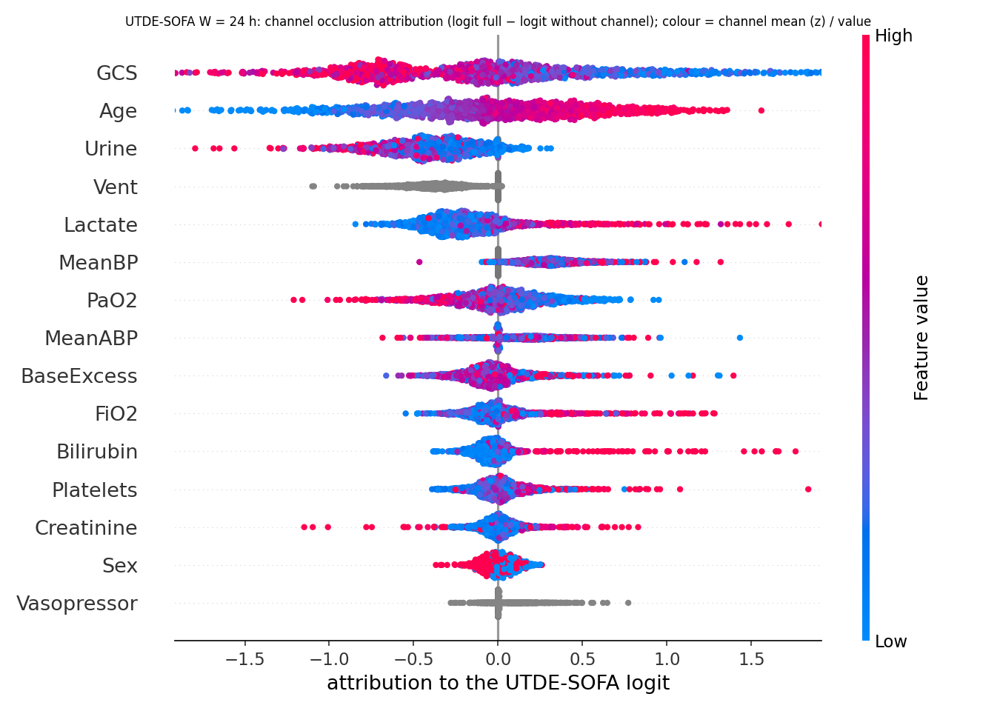
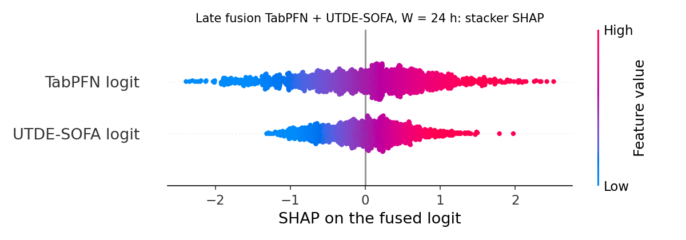
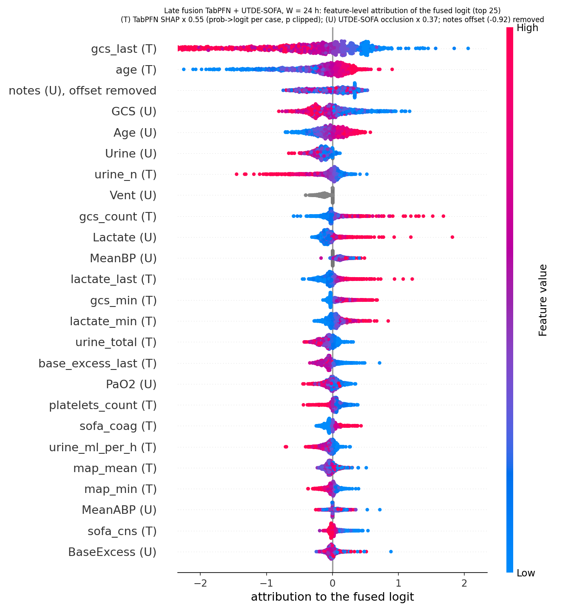
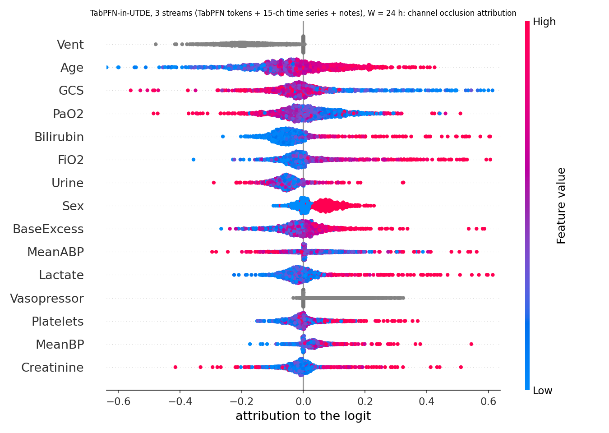
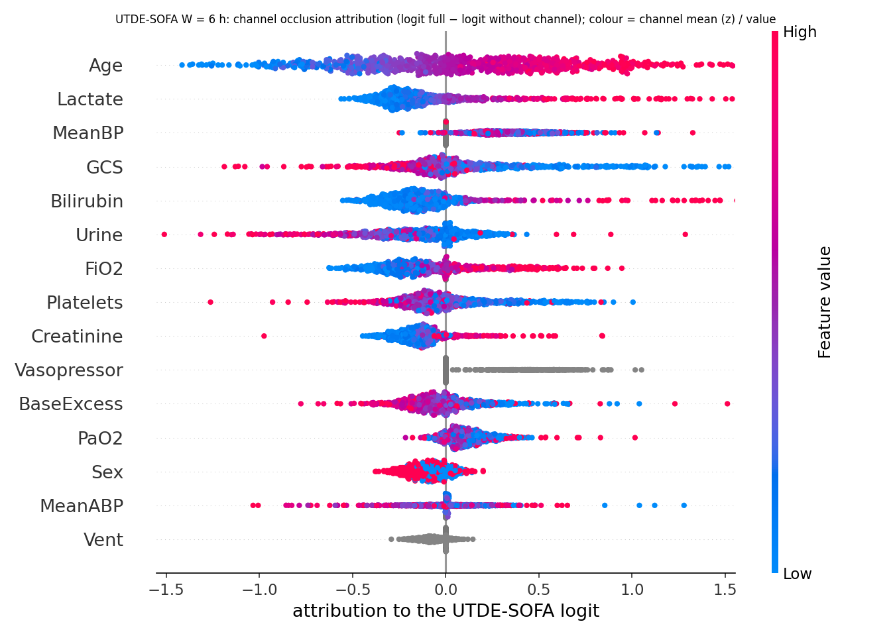
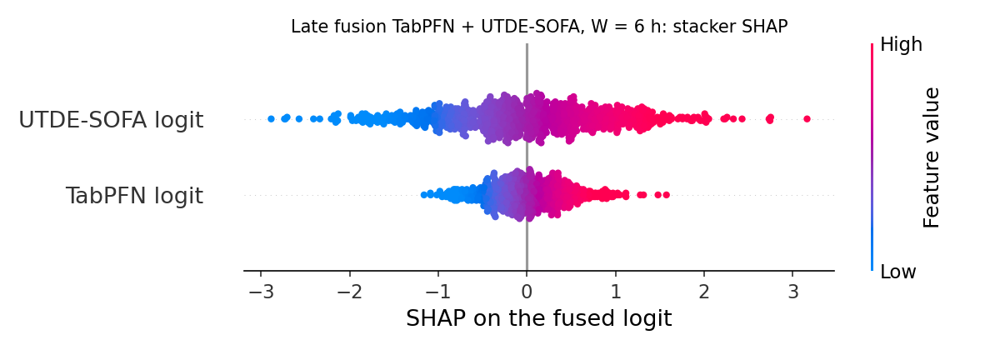
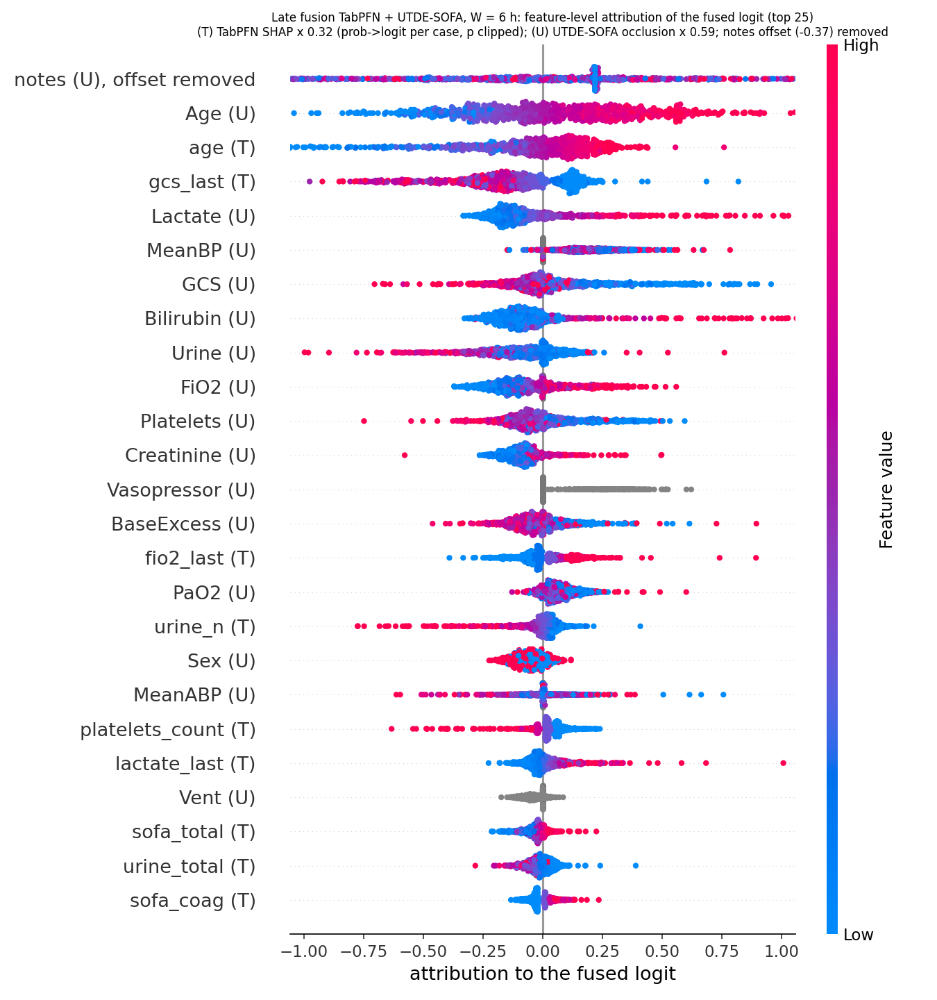
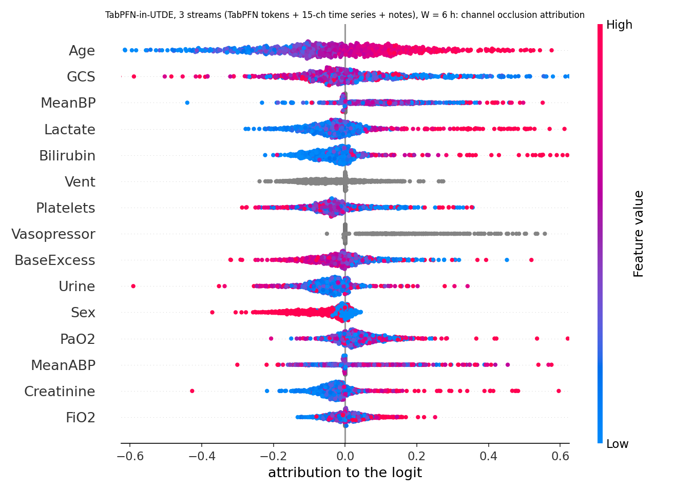

# Attribution report — unified variable set (SOFA inputs + lactate/BE + vent + age/sex)

Models of the unified table: TabPFN (68 features), UTDE-SOFA (15 channels + notes), late fusion TabPFN + UTDE-SOFA, TabPFN-in-UTDE replace, TabPFN-in-UTDE 3-stream. Test split: 853 (6 h) / 1,374 (24 h).

| model | method | figure |
|---|---|---|
| TabPFN | permutation SHAP (all test cases, probability units) | `../fusion_shap/tabpfn_shap_W{6,24}.png` |
| UTDE-SOFA | occlusion: modality (notes / time series), per channel; beeswarm coloured by channel mean | `utde_sofa_beeswarm_W{6,24}.png` |
| late fusion | exact SHAP of the logistic stacker (2 inputs) + feature-level beeswarm (TabPFN SHAP × b₁, UTDE-SOFA occlusion × b₂, notes offset-centred) | `fusion_sofa_stacker_W{6,24}.png`, `fusion_sofa_feature_beeswarm_W{6,24}.png` |
| replace | occlusion of the TabPFN tokens and of the notes (no time-series stream) | table only |
| 3-stream | occlusion of the TabPFN tokens, notes, time-series stream and each channel; channel beeswarm | `tabemb3_sofa_beeswarm_W{6,24}.png` |

## Headline numbers

| model | 6 h: drives it | 6 h: notes removed | 24 h: drives it | 24 h: notes removed |
|---|---|---|---|---|
| TabPFN | age ≈ gcs_last > fio2_last, lactate, urine | – | gcs_last ≫ age > urine_n, gcs_count, lactate, BE | – |
| UTDE-SOFA | Age (−0.023) ≈ GCS (−0.024) > bilirubin, BE | 0.823 → 0.805 (−0.018) | GCS (−0.057) > Age (−0.020) > lactate, PaO2 | 0.826 → 0.803 (−0.023) |
| late fusion | UTDE-SOFA logit 69 %, notes (U) top feature | via UTDE logit | TabPFN logit 61 %, gcs_last (T) top | via UTDE logit |
| replace | TabPFN tokens (−0.251) | 0.827 → 0.826 (−0.001) | TabPFN tokens (−0.274) | 0.836 → 0.834 (−0.002) |
| 3-stream | TabPFN tokens (−0.050) > notes ≈ TS (−0.007) | 0.835 → 0.828 (−0.007) | TabPFN tokens (−0.091) > notes (−0.016) > TS (−0.005) | 0.856 → 0.840 (−0.016) |

## Figures

### W = 24 h

### W = 6 h

## Full tables

See `summary_W24.md` and `summary_W6.md` in this folder (per-channel Δlogit / AUROC drops, stacker coefficients, top-15 fused-logit attributions, occlusion tables of the replace and 3-stream models).

## Reading

1. With identical variables all five models lean on the same two things — GCS and age — plus lactate / urine; the structure only changes *how* they are combined.
2. The late fusion weights the two logits by their spread (UTDE-SOFA 69 % at 6 h, TabPFN 61 % at 24 h) but their correlation is 0.83–0.91, so the fused prediction is mostly a re-scaling.
3. The replace model is TabPFN in disguise: removing the TabPFN tokens costs 0.25–0.27 AUROC, removing the notes costs ≤ 0.002.
4. The 3-stream model is the only one in which the notes are used on top of TabPFN (−0.016 at 24 h), and that is where its +0.019 comes from; its time-series stream contributes little directly (−0.005) but is what lets the note branch train.
5. Notes matter only at 24 h; at 6 h every model reduces to "age + GCS + a few labs", which TabPFN already captures.
